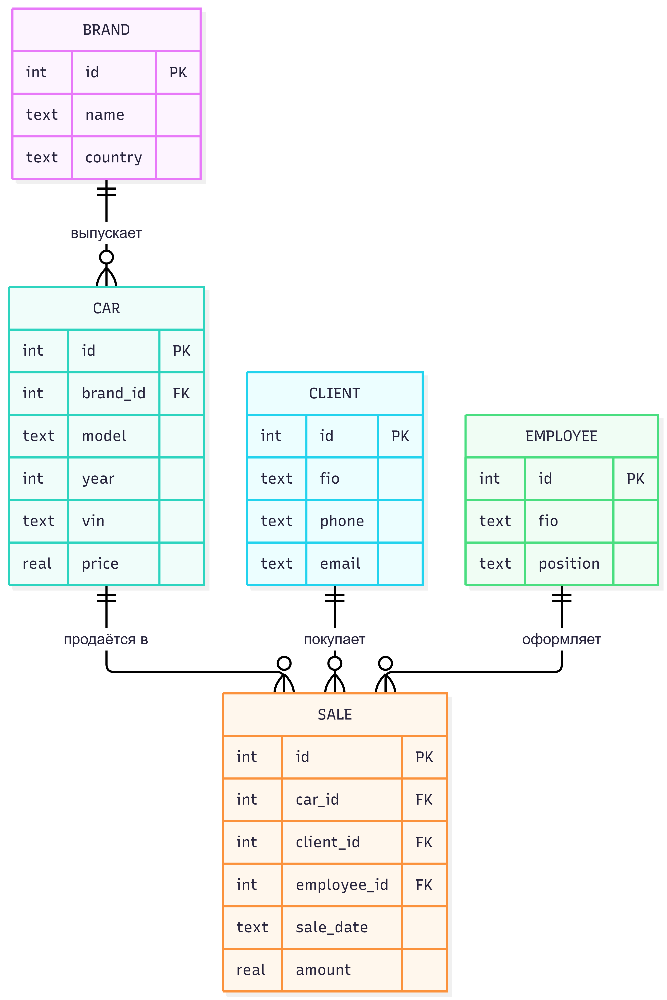

# Практическая работа 02. ER-диаграмма

**ФИО:** Панова Алексей Александрович
**Группа:** 3ИП-10-24
**Дата выполнения:** 13.10.2026

---

## 1. Цель работы

Научиться проектировать ER-диаграмму (нотация «воронья лапка») в draw.io: выделять сущности, определять атрибуты, ключи и типы связей между ними.

## 2. Инструменты

- mermaid.ai

## 3. Сущности и атрибуты

### Марка
| Атрибут | Тип | Ключ | NULL |
|---|---|---|---|
| id | int | PK | NOT NULL |
| name | text | | NOT NULL |
| country | text | | NULL |

### Автомобиль
| Атрибут | Тип | Ключ | NULL |
|---|---|---|---|
| id | int | PK | NOT NULL |
| brand_id | int | FK → Марка.id | NOT NULL |
| model | text | | NOT NULL |
| year | int | | NOT NULL |
| vin | text | | NOT NULL (уникальный) |
| color | text | | NULL |
| price | real | | NOT NULL |

### Клиент
| Атрибут | Тип | Ключ | NULL |
|---|---|---|---|
| id | int | PK | NOT NULL |
| fio | text | | NOT NULL |
| phone | text | | NOT NULL |
| email | text | | NULL |

### Сотрудник
| Атрибут | Тип | Ключ | NULL |
|---|---|---|---|
| id | int | PK | NOT NULL |
| fio | text | | NOT NULL |
| position | text | | NOT NULL |
| phone | text | | NULL |

### Продажа
| Атрибут | Тип | Ключ | NULL |
|---|---|---|---|
| id | int | PK | NOT NULL |
| car_id | int | FK → Автомобиль.id | NOT NULL |
| client_id | int | FK → Клиент.id | NOT NULL |
| employee_id | int | FK → Сотрудник.id | NOT NULL |
| sale_date | text | | NOT NULL |
| amount | real | | NOT NULL |

## 4. ER-диаграмма



Исходный файл: `diagram.mmd`

## 5. Связи и их типы

| № | Связь | Тип | Пояснение |
|---|---|---|---|
| 1 | Марка — Автомобиль | 1:N | Одна марка — много автомобилей |
| 2 | Автомобиль — Продажа | 1:N | Один автомобиль может фигурировать в нескольких продажах (возврат, перепродажа) |
| 3 | Клиент — Продажа | 1:N | Один клиент — много покупок |
| 4 | Сотрудник — Продажа | 1:N | Один сотрудник оформляет много продаж |
| 5 | Клиент — Автомобиль | M:N | Разбита через таблицу «Продажа» |

## 6. Словесное описание связи «Клиент — Продажа»

Один клиент может совершить ноль или много покупок. Каждая продажа относится ровно к одному клиенту. На диаграмме со стороны «Клиент» стоит символ «один» (`||`), со стороны «Продажа» — «ноль или много» (`o<`). Внешний ключ `client_id` находится в таблице «Продажа» (на стороне «многие»).

## 7. Связь M:N и её разбиение

Между сущностями **Клиент** и **Автомобиль** существует связь M:N: клиент может купить много автомобилей, а один автомобиль со временем может принадлежать разным клиентам.

В реляционной БД M:N напрямую не реализуется, поэтому она разбита на две связи 1:N через промежуточную таблицу **Продажа**:

```
Клиент 1 ——— N Продажа N ——— 1 Автомобиль
```

Таблица «Продажа» содержит два внешних ключа (`client_id`, `car_id`) и собственные атрибуты (`sale_date`, `amount`).

## 8. Ограничения NULL / NOT NULL

- **Всегда NOT NULL:** все PK и FK, дата и сумма продажи, ФИО клиента и сотрудника, модель, год, VIN и цена автомобиля, название марки.
- **Могут быть NULL:** страна марки, цвет автомобиля, email клиента, телефон сотрудника.

Обоснование: без обязательных полей запись теряет смысл (продажа без клиента или автомобиля), а необязательные поля не влияют на целостность данных.

## 9. Дополнительные задания

### Задача «со звёздочкой»: Ресторан
Сущности: Блюдо, Категория, Заказ, Столик, Официант, Клиент + промежуточная таблица Позиция_заказа.

| Связь | Тип |
|---|---|
| Категория — Блюдо | 1:N |
| Столик — Заказ | 1:N |
| Официант — Заказ | 1:N |
| Клиент — Заказ | 1:N |
| Заказ — Блюдо | M:N → через Позиция_заказа (id, order_id FK, dish_id FK, quantity) |

Диаграмма: `restaurant.png` / `restaurant.drawio`

### Задача на поиск ошибки: Парковка
**Ошибка:** нарисованы две противоречащие связи — «Автомобиль 1:N Место» и «Место 1:N Автомобиль». Связь между двумя сущностями должна быть одной и иметь один тип.

**Исправление:** оставить одну связь «Место 1:N Автомобиль» (на одном месте со временем паркуется много автомобилей), FK `place_id` ставится на стороне «многие». Если нужно учитывать время стоянки, использовать M:N с промежуточной таблицей «Стоянка» (car_id, place_id, время_начала, время_конца).

### Задача на предсказание результата: Химчистка
В таблице «Позиция» будет **2 внешних ключа**: `order_id` (на «Заказ») и `service_id` (на «Услуга»). Связь «Клиент — Заказ» даёт FK в таблице «Заказ», а не в «Позиция».

## 10. Выводы

В ходе работы построена ER-диаграмма предметной области «Автосалон» из 5 сущностей, определены типы связей, ключи и допустимость NULL. Связь M:N между клиентами и автомобилями разбита через таблицу «Продажа». Диаграмма экспортирована в PNG.

## 11. Файлы в папке

- `diagram.mmd` — исходник диаграммы
- `diagram.png` — экспорт
- `diagram.svg` — экспорт в svg
- `otchet.md` — этот отчёт
