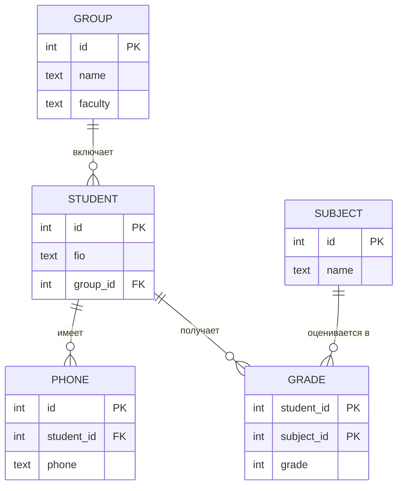

# Практическая работа 03. Нормализация

**ФИО:** Панов Алексей Александрович
**Группа:** 3ИП-10-24
**Дата выполнения:** 14.10.2026

---

## 1. Цель работы

Научиться приводить таблицы к 1НФ, 2НФ, 3НФ и BCNF, находить нарушения нормальных форм и устранять аномалии вставки, обновления и удаления.

## 2. Краткая теория

| Форма | Правило | Что устраняет |
|---|---|---|
| 1НФ | Все значения атомарны, нет повторяющихся групп | Списки в одной ячейке |
| 2НФ | 1НФ + нет частичных зависимостей от составного ключа | Зависимость от части ключа |
| 3НФ | 2НФ + нет транзитивных зависимостей | Цепочки «ключ → A → B» |
| BCNF | Для каждой зависимости X → Y, X — суперключ | Зависимости от несуперключа |

---

## 3. Задание 1. Приведение к 1НФ

**Исходная таблица «Студент»:**

| id | ФИО | Телефоны | Дисциплины |
|---|---|---|---|
| 1 | Иванов И.И. | 111-22-33, 444-55-66 | Математика, Физика |
| 2 | Петров П.П. | 555-66-77 | Математика |
| 3 | Сидоров С.С. | 888-99-00, 123-45-67 | Химия, Биология, Физика |

**Что нарушено:** в столбцах «Телефоны» и «Дисциплины» в одной ячейке хранится несколько значений (нарушена атомарность). Нельзя искать по одному номеру телефона или по одной дисциплине без разбора строки.

**Решение.** Телефоны и дисциплины между собой не связаны, поэтому, если просто разнести их по строкам одной таблицы, получится «перемножение» (у Иванова 2 × 2 = 4 строки, у Сидорова 2 × 3 = 6). Чтобы этого избежать, выносим каждый многозначный атрибут в отдельную таблицу.

**Студент**

| id | ФИО |
|---|---|
| 1 | Иванов И.И. |
| 2 | Петров П.П. |
| 3 | Сидоров С.С. |

**Телефон_студента**

| id_студента | Телефон |
|---|---|
| 1 | 111-22-33 |
| 1 | 444-55-66 |
| 2 | 555-66-77 |
| 3 | 888-99-00 |
| 3 | 123-45-67 |

**Студент_дисциплина**

| id_студента | Дисциплина |
|---|---|
| 1 | Математика |
| 1 | Физика |
| 2 | Математика |
| 3 | Химия |
| 3 | Биология |
| 3 | Физика |

---

## 4. Задание 2. Приведение к 2НФ

**Исходная таблица «Оценка»** (составной ключ `(id_студента, id_дисциплины)`):

| id_студента | id_дисциплины | ФИО | Название_дисциплины | Оценка |
|---|---|---|---|---|
| 1 | 10 | Иванов | Математика | 5 |
| 1 | 11 | Иванов | Физика | 4 |
| 2 | 10 | Петров | Математика | 3 |
| 3 | 11 | Сидоров | Физика | 5 |

**Что нарушено:** частичные зависимости от составного ключа:
- `ФИО` зависит только от `id_студента`;
- `Название_дисциплины` зависит только от `id_дисциплины`.

Следствие: ФИО и название дисциплины дублируются в каждой строке.

**Решение:**

**Студент**

| id | ФИО |
|---|---|
| 1 | Иванов |
| 2 | Петров |
| 3 | Сидоров |

**Дисциплина**

| id | Название |
|---|---|
| 10 | Математика |
| 11 | Физика |

**Оценка**

| id_студента | id_дисциплины | Оценка |
|---|---|---|
| 1 | 10 | 5 |
| 1 | 11 | 4 |
| 2 | 10 | 3 |
| 3 | 11 | 5 |

---

## 5. Задание 3. Приведение к 3НФ

**Исходная таблица «Студент»:**

| id | ФИО | Группа | Факультет |
|---|---|---|---|
| 1 | Иванов | ИС-31 | Информатики |
| 2 | Петров | ИС-31 | Информатики |
| 3 | Сидоров | ЭК-21 | Экономики |
| 4 | Кузнецов | ЭК-21 | Экономики |
| 5 | Смирнов | ИС-32 | Информатики |

**Что нарушено:** транзитивная зависимость `id → Группа → Факультет`. Факультет определяется группой, а не студентом напрямую. Из-за этого название факультета повторяется для каждого студента группы.

**Решение:**

**Студент**

| id | ФИО | id_группы |
|---|---|---|
| 1 | Иванов | 1 |
| 2 | Петров | 1 |
| 3 | Сидоров | 2 |
| 4 | Кузнецов | 2 |
| 5 | Смирнов | 3 |

**Группа**

| id | Название | Факультет |
|---|---|---|
| 1 | ИС-31 | Информатики |
| 2 | ЭК-21 | Экономики |
| 3 | ИС-32 | Информатики |

---

## 6. Задание 4. Итоговая схема после заданий 1–3

Таблицы: Группа, Студент, Телефон_студента, Дисциплина, Оценка. Таблица «Оценка» из задания 2 одновременно служит связью M:N между студентами и дисциплинами (вместо «Студент_дисциплина» из задания 1).

| Связь | Тип |
|---|---|
| Группа — Студент | 1:N |
| Студент — Телефон_студента | 1:N |
| Студент — Дисциплина | M:N, разбита через «Оценка» |

Скриншот схемы: `schema.png`

---

## 7. Задание 5. Транзитивная зависимость

**Транзитивная зависимость** — это ситуация, когда неключевой столбец зависит от ключа не напрямую, а через другой неключевой столбец: `ключ → A → B`, где A не является ключом.

**Пример (из автосалона):**

| id | VIN | Марка | Страна_марки |
|---|---|---|---|
| 1 | XTA001 | Lada | Россия |
| 2 | XTA002 | Lada | Россия |
| 3 | WBA003 | BMW | Германия |

Цепочка: `id → Марка → Страна_марки`. Страна определяется маркой, а не конкретным автомобилем. Страна «Россия» дублируется, а при смене данных о марке придётся править много строк.

**Решение:** `Автомобиль(id, VIN, id_марки)` и `Марка(id, название, страна)`.

---

## 8. Задание 6. Таблица «Заказ» до 3НФ

**Исходная таблица:**

| id_заказа | Дата | Клиент | Телефон_клиента | Товар | Цена_товара | Количество |
|---|---|---|---|---|---|---|
| 1 | 01.02 | Иванов | 111 | Хлеб | 40 | 2 |
| 1 | 01.02 | Иванов | 111 | Молоко | 60 | 1 |
| 2 | 02.02 | Петров | 444 | Хлеб | 40 | 3 |
| 3 | 03.02 | Иванов | 111 | Мыло | 80 | 1 |

Так как `id_заказа` повторяется, ключ составной: `(id_заказа, Товар)`.

**Шаг 1 (1НФ):** все значения атомарны, повторяющихся групп нет, таблица в 1НФ.

**Шаг 2 (2НФ):** есть частичные зависимости от части ключа:
- `Дата`, `Клиент`, `Телефон_клиента` зависят только от `id_заказа`;
- `Цена_товара` зависит только от `Товар`.

Выносим в отдельные таблицы.

**Шаг 3 (3НФ):** остаётся транзитивная зависимость `id_заказа → Клиент → Телефон_клиента`. Телефон выносим в таблицу «Клиент».

**Результат:**

**Клиент**

| id | ФИО | Телефон |
|---|---|---|
| 1 | Иванов | 111 |
| 2 | Петров | 444 |

**Заказ**

| id | Дата | id_клиента |
|---|---|---|
| 1 | 01.02 | 1 |
| 2 | 02.02 | 2 |
| 3 | 03.02 | 1 |

**Товар**

| id | Название | Цена |
|---|---|---|
| 1 | Хлеб | 40 |
| 2 | Молоко | 60 |
| 3 | Мыло | 80 |

**Позиция_заказа**

| id_заказа | id_товара | Количество |
|---|---|---|
| 1 | 1 | 2 |
| 1 | 2 | 1 |
| 2 | 1 | 3 |
| 3 | 3 | 1 |

**Проверка:** соединив таблицы по ключам, получаем исходные 4 строки, данные не потеряны.

---

## 9. Задание 7. Таблица «Сотрудник»

| id | ФИО | Отдел | Руководитель_отдела |
|---|---|---|---|
| 1 | Иванов | Бухгалтерия | Петров |
| 2 | Сидоров | Бухгалтерия | Петров |
| 3 | Кузнецов | IT | Смирнов |
| 4 | Морозов | IT | Смирнов |

**Определение формы:**
- 1НФ: значения атомарны, форма выполняется.
- 2НФ: ключ простой (`id`), значит выполняется автоматически.
- 3НФ: нарушена. Есть транзитивная зависимость `id → Отдел → Руководитель_отдела`.

**Вывод:** таблица находится во **2НФ**.

**Приведение к 3НФ:**

**Отдел**

| id | Название | Руководитель |
|---|---|---|
| 1 | Бухгалтерия | Петров |
| 2 | IT | Смирнов |

**Сотрудник**

| id | ФИО | id_отдела |
|---|---|---|
| 1 | Иванов | 1 |
| 2 | Сидоров | 1 |
| 3 | Кузнецов | 2 |
| 4 | Морозов | 2 |

---

## 10. Задание 8. Таблица «Расписание»

| День | Время | Группа | Предмет | Преподаватель | Аудитория |
|---|---|---|---|---|---|
| Пн | 9:00 | ИС-31 | Математика | Петров | 101 |
| Пн | 10:30 | ИС-31 | Физика | Сидоров | 202 |
| Вт | 9:00 | ИС-31 | Математика | Петров | 101 |
| Вт | 9:00 | ЭК-21 | Экономика | Кузнецов | 303 |
| Ср | 9:00 | ИС-31 | Физика | Сидоров | 202 |

**Принятые допущения:**
- ключ: `(День, Время, Группа)` — у группы в одно время одно занятие;
- каждый преподаватель ведёт один предмет (`Преподаватель → Предмет`);
- аудитория относится к конкретному занятию.

**Нарушения:**
- 1НФ: выполняется.
- 2НФ: выполняется, частичных зависимостей от части ключа нет.
- 3НФ: нарушена транзитивная зависимость `(День, Время, Группа) → Преподаватель → Предмет`. Предмет определяется преподавателем.

**Результат:**

**Предмет**

| id | Название |
|---|---|
| 1 | Математика |
| 2 | Физика |
| 3 | Экономика |

**Преподаватель**

| id | ФИО | id_предмета |
|---|---|---|
| 1 | Петров | 1 |
| 2 | Сидоров | 2 |
| 3 | Кузнецов | 3 |

**Группа**

| id | Название |
|---|---|
| 1 | ИС-31 |
| 2 | ЭК-21 |

**Занятие**

| День | Время | id_группы | id_преподавателя | Аудитория |
|---|---|---|---|---|
| Пн | 9:00 | 1 | 1 | 101 |
| Пн | 10:30 | 1 | 2 | 202 |
| Вт | 9:00 | 1 | 1 | 101 |
| Вт | 9:00 | 2 | 3 | 303 |
| Ср | 9:00 | 1 | 2 | 202 |

---

## 11. Задача «со звёздочкой»: BCNF

| Студент | Предмет | Преподаватель |
|---|---|---|
| Иванов | Математика | Петров |
| Иванов | Физика | Сидоров |
| Петров | Математика | Петров |
| Сидоров | Физика | Сидоров |

**Зависимости:**
- `(Студент, Предмет) → Преподаватель`;
- `Преподаватель → Предмет` (каждый преподаватель ведёт один предмет).

Ключ таблицы: `(Студент, Предмет)` (или `(Студент, Преподаватель)`). В зависимости `Преподаватель → Предмет` левая часть не является суперключом, поэтому таблица в 3НФ (Предмет — часть ключа), но **не в BCNF**.

**Приведение к BCNF:**

**Преподаватель_предмет**

| Преподаватель | Предмет |
|---|---|
| Петров | Математика |
| Сидоров | Физика |

**Студент_преподаватель**

| Студент | Преподаватель |
|---|---|
| Иванов | Петров |
| Иванов | Сидоров |
| Петров | Петров |
| Сидоров | Сидоров |

**Проверка:** соединение по `Преподаватель` восстанавливает исходные 4 строки. Преподаватель в первой таблице — ключ, значит условие BCNF выполнено.

---

## 12. Задача на поиск ошибки

**Утверждение:** таблица «Студент (id, ФИО, телефон1, телефон2)» находится в 1НФ.

**Что не так:** `телефон1` и `телефон2` — это повторяющаяся группа столбцов, а 1НФ запрещает повторяющиеся группы. Проблемы такого дизайна:
- для третьего телефона придётся менять структуру таблицы;
- поиск по номеру требует проверять оба столбца;
- у студентов с одним телефоном остаются пустые значения (NULL).

**Исправление:** вынести телефоны в таблицу `Телефон_студента(id, id_студента, телефон)`, по одной строке на номер.

---

## 13. Задача на предсказание результата

Таблица «Книга» (id, название, автор, год). После выноса автора в отдельную таблицу получаем:
- `Книга(id, название, id_автора, год)`;
- `Автор(id, ФИО)`.

**Ответ:** таблицы находятся в **3НФ**. Ключи простые (2НФ выполняется автоматически), транзитивных зависимостей нет, повторение имени автора устранено.

---

## 14. Выводы

В ходе работы таблицы приведены к 1НФ, 2НФ, 3НФ, а также к BCNF. Нарушения были связаны со списками в ячейках, зависимостью от части составного ключа и транзитивными зависимостями. После нормализации дублирование устранено, аномалии вставки, обновления и удаления исключены, а исходные данные восстанавливаются соединением таблиц.

## 15. Файлы в папке

- `otchet.md` — этот отчёт
- `schema.png` — схема из задания 4
